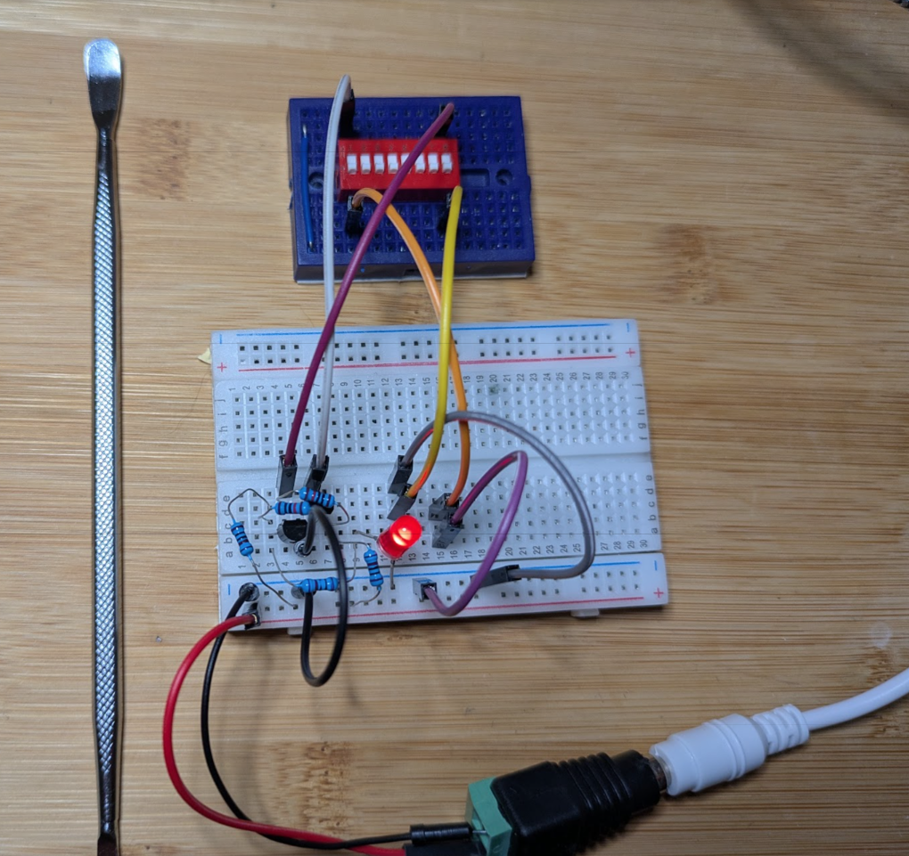

# 1-bit-h100

> *Enterprise-grade 0.000000000001 AI accelerator. Zero wattage, two 2N2222A transistors, pure unadulterated silicon flexing.*

---

## Part I: The Genesis Core (Discrete 1-Bit Latch)

Welcome to **1-bit-h100**, the world's most aggressively over-engineered, severely under-budgeted compute unit. While Silicon Valley burns billions on multi-node Blackwell clusters and H100 arrays, true innovation happens on a modest breadboard using two humble **2N2222A** NPN BJTs and a handful of resistors.

This repository documents the absolute ground floor of our architecture: a classic cross-coupled bistable multivibrator (flip-flop). It is a 1-bit memory cell that retains state using pure positive feedback.



---

### How It Works & What We Can Simulate

* **The Architecture:** Two cross-coupled transistors ($Q1$ and $Q2$) act as opposing switches. When one transistor turns completely **ON**, its collector is pulled low, starving the opposing transistor's base of current and forcing it **OFF**.
* **The State Retention:** This cross-coupling creates a permanent latch loop. It remembers its state indefinitely as long as power is applied—no clock signal required.
* **The "Sliders" / Manual Controls:**
* Instead of automated register writes, inputs are handled via manual jumpers or sliders acting as **SET** and **RESET** controls.
* **The Rule of Thumb:** Use only one slider at a time, and always flip it back off before using the other.
* **Memory vs. Pass-Through:** If you hold one control active (e.g., holding RESET), the circuit acts as a direct pass-through where the LED follows the opposite input. Once both controls are released, the cross-coupling locks the state in place—true 1-bit RAM behavior!


---

### Technical Schematic (For Engineers)

```text
               +VCC (5V Power Rail)
                 │
            ┌────┴────┐
            │         │
          [R1]      [R2]  (1kΩ Collector Resistors)
            │         │
            ├───┐     ┌───┤
            │   │     │   │
            │  [R3]  [R4] │  (10kΩ Cross-Coupling Resistors)
            │   │     │   │
     (Q1)   │   └─────┼───┼──> Base of Q2 (Row 4)
  2N2222A   │         │   │
  Collector ├───┐     │   │
  (Row 7)   │   │     │   │
            │   └───┬─┘   │
            │       │     │
            │     (Q2)    │
            │   2N2222A   │
            │  Collector  │
            │   (Row 3)   │
            │             │
            └──────┬──────┘
                   │
            (Linked Emitters)
                   │
            [Ground Jumper]
                   │
         GND (Blue Rail, 0V)

```

* **Component Bill of Materials:**
* **$Q1, Q2$:** 2N2222A NPN Bipolar Junction Transistors
* **$R1, R2$:** $1\text{ k}\Omega$ collector load resistors
* **$R3, R4$:** $10\text{ k}\Omega$ cross-coupling feedback resistors
* **Indicator:** LED with current-limiting resistor tied to the active collector load
* **Power Supply:** Standard 5V DC breadboard rails unified on the left side


---

### Non-Engineer Quick-Start Guide (Try It at Home!)

Ever wondered how computers actually "remember" things like a 1 or a 0? You don't need a degree in electrical engineering to build one. Here is how it works under the hood, explained simply:

```text
   [SET Input]  ───>  ( Switch A ) <═══( Feedback )═══> [ LED Status ]
                           │                                 ▲
                           ▼                                 │
   [RESET Input] ───> ( Switch B ) <═══( Feedback )──────────┘

```

1. **The Teeter-Totter Analogy:** Imagine two light switches wired together in a tug-of-war so that whenever one switch is flipped **ON**, it forces the other one **OFF**. They fight each other, but once one wins, it locks in that position permanently.
2. **The "Slider" Controls:**
* Tapping or sliding a wire to ground on one side acts as your **SET** or **RESET**.
* One command turns the indicator LED on (storing a `1`), and the other puts it out (storing a `0`).


3. **Why It Matters:** You just built a literal "memory bit"—the exact same fundamental building block that stores data inside modern computer RAM and CPU caches, stripped down to its bare, beautiful, physical essence.

---

### Up Next: Part II

*Stay tuned for the upcoming hardware expansion when the 74HCT175 and 74HCT86 chips arrive...*

